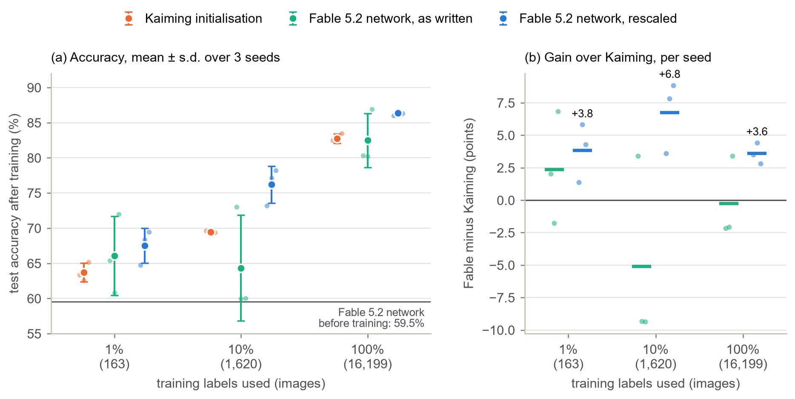
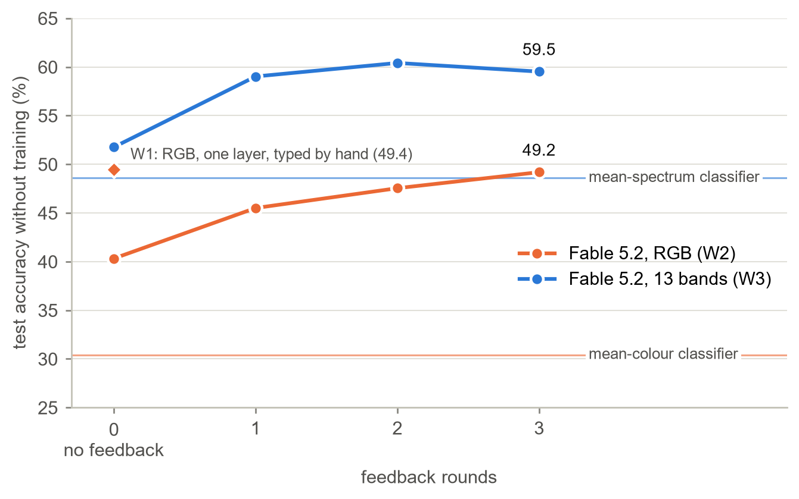

# Weight-space programming on EuroSAT

Can a language model write the weights of a working satellite-image classifier itself, with no training data and no gradient descent? This repository tests that on EuroSAT, following the framework of Takehi, Teoh, Zhang and Khattab, [*Sparks of Weight-Space Programming*](https://rikiyat.github.io/blog/weight-space-programming/) (MIT CSAIL, 2026).



*A two-layer CNN for 13-band Sentinel-2 images, trained from three starting points: standard Kaiming initialisation, and a network whose 6,858 weights Claude Fable 5.2 wrote from remote-sensing knowledge alone. (a) Test accuracy after training, mean ± standard deviation over three seeds, with each seed shown. Before any training, Fable's network already scores 59.5%. (b) Gain over Kaiming for the same seed and the same training images. Once its oversized classifier is rescaled, which leaves its predictions unchanged, Fable's network is the better starting point on every seed at every label budget.*

## In short

- **Writing whole networks without data works, up to a point.** With no tools, no data and no training, Claude Fable 5.2 wrote EuroSAT classifiers that reached 49% on RGB images and 60% on 13-band multispectral images, against 30% and 49% for trivial colour or spectrum classifiers.
- **Physics is what makes the difference.** With infrared bands, Fable built vegetation, water and bare-soil indices; lakes, forests and rivers became almost perfectly recognised, while highways, houses and industrial sites stayed hard to separate.
- **The written network is a useful starting point.** Used to initialise training, it beat standard initialisation by 3.6 to 6.8 points, most with 10% of the labels.
- **A tool-assisted pilot came first.** With Python available, Claude Fable 5.1 identified the training regime of nine networks from their weights (9 of 9) and correctly diagnosed a damaged layer as unrecoverable.

Every experiment from W1 onwards was designed, with its baselines and success criteria, before it was run ([docs/next_steps.md](docs/next_steps.md)). How this relates to the MIT study, and where it differs, is set out in [docs/comparison_with_takehi_et_al.md](docs/comparison_with_takehi_et_al.md).

## Results at a glance

| Experiment | Model, setting | What the model did | Result | Reference points |
|---|---|---|---|---|
| W1 | Fable 5.2, no tools | Typed all 618 weights of a one-layer CNN, RGB | **49.4%** test accuracy, no training | best constant guess 11.3%, mean-colour classifier 30.4%, trained 62.9% |
| W2 | Fable 5.2, no tools | Wrote a program for all 5,418 weights of a two-layer CNN, RGB, 3 feedback rounds | **40.3% → 49.2%** | random weights 8.1%, trained 78.7% |
| W3 | Fable 5.2, no tools | The same on 13-band multispectral images | **51.8% → 59.5%** (peak 60.4%) | mean-spectrum classifier 48.6%, trained 81.5% |
| W3-init | Fable 5.2 network, trained | W3's network as a starting point for training | **+3.6 to +6.8 points** over Kaiming, every seed | see figure above |
| READ | Fable 5.1, with Python | Labelled 9 blind CNNs by training regime from their weights | **9 / 9** | 1 in 1,680 by chance |
| EDIT | Fable 5.1, with Python | Repaired a noise-damaged ResNet-18 layer from the tensor alone | **95.5%** | damaged 57.7%, original 98.2%, zeroing the damaged filters 94.1% |
| WRITE | Fable 5.1, with Python | Wrote the first layer of a CNN, then trained it | 90.81% ± 0.22 | Kaiming 90.35% ± 0.48 |

## Writing whole networks with no tools and no training (W1 to W3)

Fable 5.2 ran in a claude.ai chat with code execution, web search and memory switched off. It received the architecture, the input format and the class names; it never saw an image. Each network was evaluated exactly as written on the 5,400 test images. In W2 and W3 it could revise its program up to three times after seeing its accuracy and confusion matrix on 1,000 validation images; the test set was never shown.



*Networks written by Fable 5.2, evaluated with no training. Each line is one chat; round 0 is the first answer. Horizontal lines are the trivial classifiers on average colour (RGB) and average spectrum (13 bands). The diamond is W1, a smaller network typed out by hand.*

All of Fable's designs were interpretable: colour, darkness, smoothness and edge detectors, or spectral indices, feeding a nearest-centroid classifier whose class profiles Fable estimated from its own knowledge of EuroSAT. Feedback helped by correcting those profiles, never by changing what the network computes, and it stopped helping after one round in W3. The deeper RGB network did not beat the single-layer one (49.2% against 49.4%): the limit was the model's knowledge of the classes, not network size.

The multispectral gain is partly in the data: a trivial mean-spectrum classifier also rises from 30.4% to 48.6%, so Fable's margin over it is smaller than with RGB (+10.9 against +18.8 points). What changes is the share of the trained network's accuracy that hand-writing reaches: 73% with 13 bands against 63% with RGB.

Logs: [W1](eurosat_wsp/experiment_4_write_full/), [W2](eurosat_wsp/experiment_5_write_code/runs/log.md), [W3 and W3-init](eurosat_wsp/experiment_6_write_multispectral/runs/log.md).

### As a starting point for training (W3-init)

| Training labels | Kaiming | Fable, as written | Fable, rescaled |
|---|---|---|---|
| 1% (163 images) | 63.7% | 66.1% (unstable) | **67.5%** |
| 10% (1,620 images) | 69.4% | 64.3% (unstable) | **76.2%** |
| 100% (16,199 images) | 82.8% | 82.5% (unstable) | **86.3%** |

Fable's classifier weights reach 6,000, against about 0.1 for standard initialisation. Used as written, this saturates the softmax, and some seeds barely train. Dividing the classifier by one constant leaves every prediction unchanged and makes the network trainable; that rescaling was fixed before any run.

## The tool-assisted pilot (READ, EDIT, WRITE)

Claude Fable 5.1 ran these three experiments in one Claude Code session on 10 November 2026, with Python available and blindness rules on the answer keys. How it reasoned is written up in [eurosat_wsp/runs/fable_reasoning_log.md](eurosat_wsp/runs/fable_reasoning_log.md); the full session record and a blindness audit are in [eurosat_wsp/runs/evidence/](eurosat_wsp/runs/evidence/). Because tools were allowed and the WRITE network was trained afterwards, this pilot is not a replication of Takehi et al.

### READ: the seed structure is visible in the weights


*The nine models fall into three groups that share a random initialisation. Within a group, first-layer weights correlate at 0.95 to 0.99; across groups, below 0.07. Since each regime was trained once per seed, every group holds one model of each regime.*


*Within each seed, stronger augmentation makes first-layer filters more colour-invariant and the classifier more concentrated. Lines join models that share a seed.*

### EDIT: neutralising is the right repair when the signal is gone


*Seven repair methods that use only the damaged tensor, on three corruption types. On variant A the noise is 35 times stronger than the weights, so the damaged filters cannot be reconstructed, and zeroing them already recovers most of the accuracy. The conditional-mean method, the estimator Fable chose, matters most when part of the signal survives (B) or a whole block is missing (C). Truncated SVD makes every variant worse. Fable worked only on variant A; everything else was added afterwards as baselines.*

### WRITE: a hand-written first layer trains as well as a random one


*Left: validation accuracy over 20 epochs, mean and range over three seeds. Right: test accuracy per seed. Fable's first layer came out ahead on all three seeds, by 0.13, 0.54 and 0.70 points; with three seeds this is suggestive, not significant (paired t-test, p ≈ 0.12).*


*The 16 filters Fable wrote, per colour channel; red is positive and blue negative.*

## Limitations

- **One model per experiment, few attempts.** W1 rests on a single attempt (a planned second attempt was skipped to save model usage); W2 and W3 are one chat each. Other models, or reruns of the same one, may differ.
- **Two model versions.** The pilot used Claude Fable 5.1; W1 to W3 used Claude Fable 5.2. Comparisons between the pilot and the later experiments mix model version and protocol.
- **Remembered knowledge.** Fable cited EuroSAT statistics from memory. This is allowed, but part of each result reflects what the model learned about this benchmark during its own training.
- **Three seeds.** Training comparisons use three seeds per setting; the W3-init rescaled result holds on every seed, but the intervals are wide.
- **Not tested without tools:** reading weights (R2) and fixing a behavioural flaw (E2) are designed in [docs/next_steps.md](docs/next_steps.md) but were not run.
- **Answer keys are in the repository.** Anyone evaluating a new model must withhold `eurosat_wsp/prompts/key_*.json`, `eurosat_wsp/experiment_1_read/checkpoints/`, `eurosat_wsp/experiment_2_edit/original/` and every `baselines`, `private` and `runs` folder from it.

## Data

**EuroSAT** (Helber et al., 2018, 2019) contains 27,000 Sentinel-2 image patches of 64 × 64 pixels over 34 European countries, in 10 land-use and land-cover classes. This repository uses two Hugging Face copies:

| Version | Source | Used in | Notes |
|---|---|---|---|
| RGB (3 bands) | [`blanchon/EuroSAT_RGB`](https://huggingface.co/datasets/blanchon/EuroSAT_RGB) | all RGB experiments | 16,200 / 5,400 / 5,400 train / validation / test; split manifests with SHA-256 checksums in `eurosat_wsp/data/splits/` |
| Multispectral (13 bands) | [`giswqs/EuroSAT_MS`](https://huggingface.co/datasets/giswqs/EuroSAT_MS) | W3, W3-init | Re-split onto the RGB splits by filename, so the test set is the same 5,400 images. `SeaLake_2335` (train) and `SeaLake_509` (validation) have no multispectral version and are excluded. Values are Level-1C digital numbers; dividing by 10,000 gives top-of-atmosphere reflectance. |

The original dataset is at [github.com/phelber/EuroSAT](https://github.com/phelber/EuroSAT). It contains modified Copernicus Sentinel-2 data.

## Reproduce

Tested with Python 3.14, PyTorch 2.14 and CUDA 12.6 on a 6 GB GPU. Install PyTorch for your CUDA version first, then run everything from the repository root:

```bash
pip install -r requirements.txt
```

The RGB dataset downloads on first use. The multispectral one (2.2 GB) is downloaded and aligned once by `w3.py prepare`, which writes 2.9 GB to `eurosat_wsp/data/ms/`.

**No-tools experiments.** Each folder holds this study's prompts, the model's replies, logs and results.

```bash
# W1: one-layer network typed by hand
python eurosat_wsp/experiment_4_write_full/w1.py baselines
python eurosat_wsp/experiment_4_write_full/w1.py eval --weights runs/w1_attempt_1/weights.pt

# W2: program-written two-layer network, RGB (rerun scoring for a given round, then summarise)
python eurosat_wsp/experiment_5_write_code/w2.py baselines
python eurosat_wsp/experiment_5_write_code/w2.py run --round 0
python eurosat_wsp/experiment_5_write_code/w2.py summary

# W3: the same on 13 bands, then the initialisation comparison (27 training runs)
python eurosat_wsp/experiment_6_write_multispectral/w3.py prepare
python eurosat_wsp/experiment_6_write_multispectral/w3.py baselines
python eurosat_wsp/experiment_6_write_multispectral/w3.py summary
python eurosat_wsp/experiment_6_write_multispectral/init_compare.py
```

`init_compare.py` keeps the data on the GPU when there is room and in host memory otherwise; it saves after every run and skips runs already done, so it can be interrupted. Delete `init_compare/results.json` to start over.

**Pilot.**

```bash
python eurosat_wsp/wsp.py eval-read --response eurosat_wsp/runs/read_run_001/raw_response.txt \
  --key eurosat_wsp/prompts/key_read_exp1_all9_models.json
python eurosat_wsp/wsp.py eval-edit --repair-script eurosat_wsp/runs/edit_run_001/parsed_output/repair_script.py --variant A
python eurosat_wsp/run_edit_baselines.py
python eurosat_wsp/wsp.py eval-write --weights eurosat_wsp/runs/write_run_001/parsed_output/first_conv_fable.pt --train --seed 0
```

**Figures.** `python eurosat_wsp/generate_figures.py` rebuilds all seven figures from the result files, as PNG and SVG in `assets/`. Pass names such as `fig6 fig7` to rebuild only some.

## Testing another model

The no-tools experiments work with any chat model.

1. **Keep this study's results.** Copy the experiment folder, or move its `runs/` and `private/` (or `baselines/`) folders aside; new runs write to the same places.
2. **Generate the prompt** with `w1.py prompt`, `w2.py prompt` or `w3.py prompt`, and paste it into a new chat with tools, web search and memory off.
3. **Save the full reply** as `runs/<attempt or round_N>/response.txt` inside the experiment folder, unedited.
4. **Score it** with `w1.py parse` and `w1.py eval`, or `w2.py run --round N` / `w3.py run --round N`. The `run` command prints the feedback to paste back for the next round and stores the test score where the model cannot see it.
5. **Compare** with `summary`, against the baselines and this study's results.

The model-written code runs in a separate Python process that rejects file, network and random-number use. Read it before running it on your own machine all the same.

## Repository layout

```text
assets/                         figures fig1 to fig7 (PNG and SVG)
docs/
  comparison_with_takehi_et_al.md   what is and is not comparable with the MIT study
  next_steps.md                     pre-registered designs, criteria and amendments
requirements.txt
eurosat_wsp/
  common.py                     data loading, SmallCNN, training loop
  wsp.py, wsp_eval.py, ...      pilot harness: prompts, parsing, evaluation
  read_features.py              READ fingerprints
  edit_repairs.py               tensor-only repair methods; run_edit_baselines.py evaluates them
  generate_figures.py           rebuilds every figure from result files
  data/                         split manifests (RGB); data/ms/ holds the aligned 13-band arrays (not in git)
  experiment_1_read/            nine SmallCNN checkpoints and metrics (pilot READ)
  experiment_2_edit/            damaged ResNet-18 checkpoints and repair results (pilot EDIT)
  experiment_3_write/           first-layer specs, Kaiming baselines, multi-seed results (pilot WRITE)
  experiment_4_write_full/      W1: harness, prompts, reply, baselines, result
  experiment_5_write_code/      W2: harness, prompt, replies per round, log, results
  experiment_6_write_multispectral/
                                W3: harness, prompt, replies per round, log, results;
                                init_compare.py and init_compare/ for W3-init
  runs/                         pilot replies, Fable 5.1 reasoning log, session evidence
```

## References

```bibtex
@misc{takehi2026weightspace,
  title        = {Sparks of Weight-Space Programming: LLMs can natively read \& write neural network weights},
  author       = {Takehi, Rikiya and Teoh, Jayden and Zhang, Alex and Khattab, Omar},
  year         = {2026},
  month        = nov,
  howpublished = {\url{https://rikiyat.github.io/blog/weight-space-programming/}}
}

@article{helber2019eurosat,
  title   = {EuroSAT: A Novel Dataset and Deep Learning Benchmark for Land Use and Land Cover Classification},
  author  = {Helber, Patrick and Bischke, Benjamin and Dengel, Andreas and Borth, Damian},
  journal = {IEEE Journal of Selected Topics in Applied Earth Observations and Remote Sensing},
  volume  = {12},
  number  = {7},
  pages   = {2217--2226},
  year    = {2019}
}

@inproceedings{helber2018introducing,
  title     = {Introducing EuroSAT: A Novel Dataset and Deep Learning Benchmark for Land Use and Land Cover Classification},
  author    = {Helber, Patrick and Bischke, Benjamin and Dengel, Andreas and Borth, Damian},
  booktitle = {IGARSS 2018 -- IEEE International Geoscience and Remote Sensing Symposium},
  pages     = {204--207},
  year      = {2018}
}

@inproceedings{he2015delving,
  title     = {Delving Deep into Rectifiers: Surpassing Human-Level Performance on ImageNet Classification},
  author    = {He, Kaiming and Zhang, Xiangyu and Ren, Shaoqing and Sun, Jian},
  booktitle = {Proceedings of the IEEE International Conference on Computer Vision (ICCV)},
  pages     = {1026--1034},
  year      = {2015}
}
```
