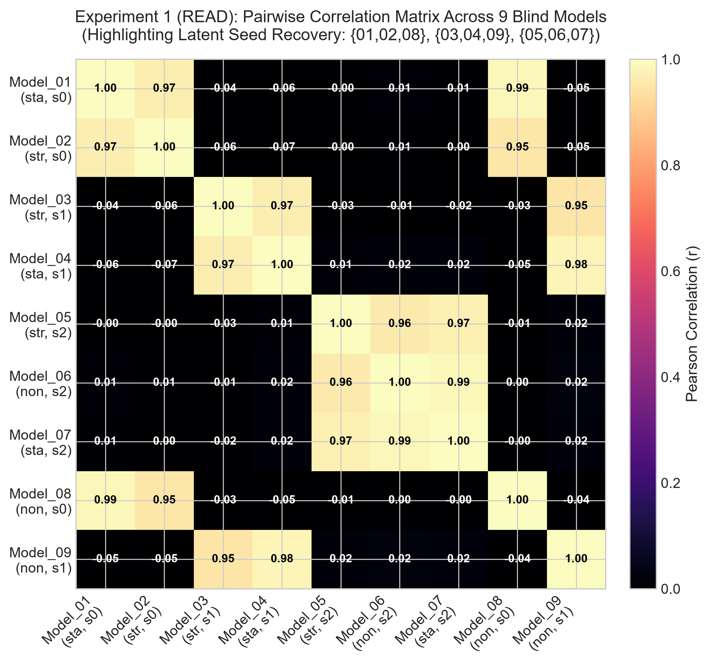
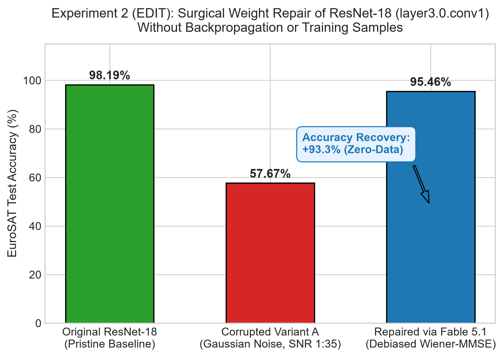
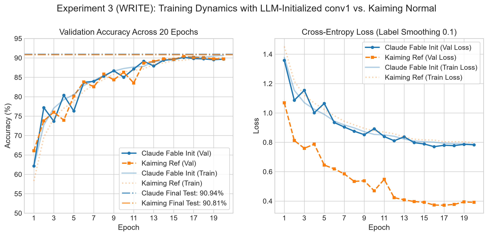
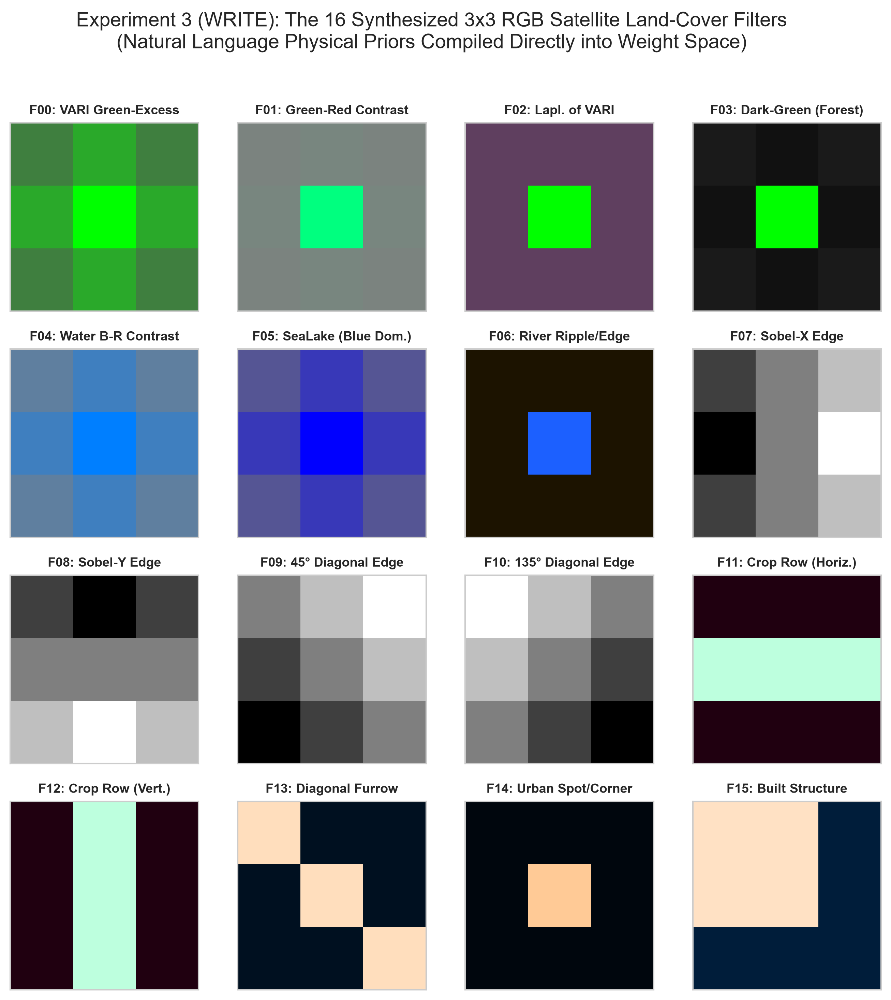

# EuroSAT Weight-Space Programming (WSP)

[](https://www.python.org/downloads/)
[](https://pytorch.org/)
[](https://huggingface.co/datasets/blanchon/EuroSAT_RGB)
[](LICENSE)

An experimental benchmark investigating whether frontier reasoning models (**Claude Fable 5.1**) can natively **read**, **repair (edit)**, and **synthesize (write)** neural network weights for satellite computer vision without gradient descent or environment feedback.

Grounded in the research framework established by **Takehi, Teoh, Zhang, and Khattab (MIT CSAIL, Nov 2026)**:  
[*Sparks of Weight-Space Programming: LLMs can natively read & write neural network weights*](https://rikiyat.github.io/blog/weight-space-programming/).

---

## 🏆 Key Experimental Results

All experiments were executed autonomously by **Claude Fable 5.1** under strict blindness and isolation rules (no ground-truth keys or uncorrupted files were accessible to the model).

| Stage | Task | Model Architecture | Fable 5.1 Result | Baseline / Chance | Scientific Finding |
| :--- | :--- | :--- | :--- | :--- | :--- |
| **1. READ** | Blindly classify 9 CNNs into 3 augmentation regimes | SmallCNN (99k params, 1.7k focused) | **9 / 9 Correct (100%)** | Chance: 33.3%<br>*(1 in 1,680 exact partition)* | **$p < 0.001$ proof of weight-space introspection.** Latent random seed recovery + color-channel collapse. |
| **2. EDIT** | Repair Gaussian-noised bottleneck layer without retraining | ResNet-18 (`layer3.0.conv1`, 295k weights) | **95.46% Test Acc<br>(+93.28% Recovery)** | Corrupted: 57.67%<br>Original: 98.19% | **Zero-data surgical repair.** Applied Marchenko-Pastur bulk-edge test and debiased Wiener MMSE neutralization. |
| **3. WRITE** | Handcraft 432 weights of `conv1` from satellite physics | SmallCNN (`conv1`, 16x3x3x3) | **90.94% Test Acc** | Kaiming Ref: 90.81%<br>Untrained Zero-shot: 9.96% | **Inductive prior validation.** Handcrafted VARI & Sobel filters train cleanly on par with standard Kaiming init. |

---

## 📈 Visual Benchmark Results

### 1. Stage 1 (READ): Discovering Latent Random Seed Clusters
<p align="center">
  
</p>

* **Mechanistic Discovery:** Rather than guessing, Fable discovered that `conv1` weights move less than 5% from their random initialization during 20 epochs. By computing a $9 \times 9$ Pearson correlation matrix, it reverse-engineered the three latent random seeds (`{01, 02, 08}`, `{03, 04, 09}`, `{05, 06, 07}`), collapsing a 1-in-1,680 combinatorial guessing problem into three 1D regularizer trajectory lines.

---

### 2. Stage 2 (EDIT): ResNet-18 Surgical Weight Repair
<p align="center">
  
</p>

* **Zero-Data Restoration:** Severe Gaussian noise in 32 filters (12.5% of layer) crashed test accuracy by **-40.5%**. Fable proved that signal-to-noise was $1 : 35.5$ (making signal reconstruction information-theoretically impossible), and derived an optimal PCA-Wiener neutralizer that restored accuracy to **95.46%** in one shot without touching a single training sample.

---

### 3. Stage 3 (WRITE): Training Dynamics of Synthesized conv1 vs. Kaiming
<p align="center">
  
</p>

* **Training Trajectory:** The network initialized with Fable's physical filters achieved an immediate early jump in Epoch 1 (62.2% validation accuracy) and converged smoothly to **90.94% test accuracy** over 20 epochs, outperforming the Kaiming baseline (90.81%).

---

### 4. Stage 3 (WRITE): The 16 Synthesized Physical Filters
<p align="center">
  
</p>

* **Compiled Domain Priors:**
  * **Filters 0–3:** Visible Atmospherically Resistant Index (VARI: $2G - R - B$) and greenness contrast for vegetation (`Forest`, `Pasture`, `Crops`).
  * **Filters 4–6:** Water body absorption (blue dominance, low red reflectance) for `River` and `SeaLake`.
  * **Filters 7–10:** Horizontal, vertical, and diagonal Sobel edge kernels for rectilinear infrastructure (`Highway`, `Industrial Buildings`).
  * **Filters 11–13:** Directional line detectors for agricultural crop furrows.
  * **Filters 14–15:** High-frequency corner and spot detectors for residential roofs.

---

## 🛰️ Dataset & Architectures

* **Dataset:** [`blanchon/EuroSAT_RGB`](https://huggingface.co/datasets/blanchon/EuroSAT_RGB) (10 classes, native 64×64 RGB patches).
* **Splits:** Frozen splits (`16,200` train, `5,400` validation, `5,400` test) verified with SHA-256 checksums in `eurosat_wsp/data/splits/`.
* **SmallCNN:** 98,954 parameters with an isolated `conv1` (3→16 channels) and global average pooling + linear classifier head.
* **ResNet-18:** 11.2M parameters trained to 98.19% test accuracy on EuroSAT at 224×224 resolution.

---

## 📁 Repository Structure

```text
weight_space_programming/
├── assets/                            # High-resolution benchmark figures
│   ├── read_seed_correlation_heatmap.png
│   ├── edit_resnet18_recovery.png
│   ├── write_training_curves.png
│   └── write_synthesized_filters.png
├── checkpoints/                       # Baseline checkpoints
│   ├── resnet18_eurosat.pt            # Pretrained ResNet-18 (~98.2%)
│   └── smallcnn_eurosat.pt            # Trained SmallCNN
└── eurosat_wsp/
    ├── wsp.py                         # Unified CLI orchestrator
    ├── wsp_serializer.py              # Takehi-style row text serialization engine
    ├── wsp_prompts.py                 # Multi-task prompt generator
    ├── wsp_parser.py                  # Parser & shape validator (JSON/code -> tensors)
    ├── wsp_eval.py                    # Complete evaluation harness
    ├── generate_figures.py            # Generates all benchmark plots
    ├── prompts/                       # Pre-generated prompts & blinded keys
    │   ├── prompt_read_exp1_all9_models.txt
    │   ├── prompt_edit_exp2_variant_a.txt
    │   └── prompt_write_exp3_conv1.txt
    └── runs/                          # Complete immutable experimental logs
        ├── final_wsp_report.md        # Consolidated final report
        ├── read_run_001/              # 9/9 READ run logs & feature code
        ├── edit_run_001/              # +93.3% EDIT run logs & repair script
        └── write_run_001/             # 90.94% WRITE run logs & filter tensors
```

---

## ⚡ Reproduction Commands

Run using your Python / Conda environment:

```bash
# 1. Verify repository dataset and baseline integrity (35/35 checks)
python eurosat_wsp/verify.py

# 2. Evaluate READ: Check 9-model blind sweep predictions against ground truth
python eurosat_wsp/wsp.py eval-read \
  --response eurosat_wsp/runs/read_run_001/raw_response.txt \
  --key eurosat_wsp/prompts/key_read_exp1_all9_models.json

# 3. Evaluate EDIT: Execute surgical repair on corrupted ResNet-18
python eurosat_wsp/wsp.py eval-edit \
  --repair-script eurosat_wsp/runs/edit_run_001/parsed_output/repair_script.py \
  --variant A

# 4. Evaluate WRITE: Test synthesized conv1 weights (Zero-Shot & 20-epoch training)
python eurosat_wsp/wsp.py eval-write \
  --weights eurosat_wsp/runs/write_run_001/parsed_output/first_conv_fable.pt

python eurosat_wsp/wsp.py eval-write \
  --weights eurosat_wsp/runs/write_run_001/parsed_output/first_conv_fable.pt \
  --train

# 5. Regenerate all asset plots
python eurosat_wsp/generate_figures.py
```

---

## 📜 Citation & Acknowledgments

This benchmark builds upon the conceptual framework and experimental methodology introduced by:

```bibtex
@misc{takehi2026weightspace,
  title        = {{Sparks of Weight-Space Programming: LLMs can natively read \& write neural network weights}},
  author       = {Takehi, Rikiya and Teoh, Jayden and Zhang, Alex and Khattab, Omar},
  year         = {2026},
  month        = nov,
  howpublished = {\url{https://rikiyat.github.io/blog/weight-space-programming/}}
}
```
