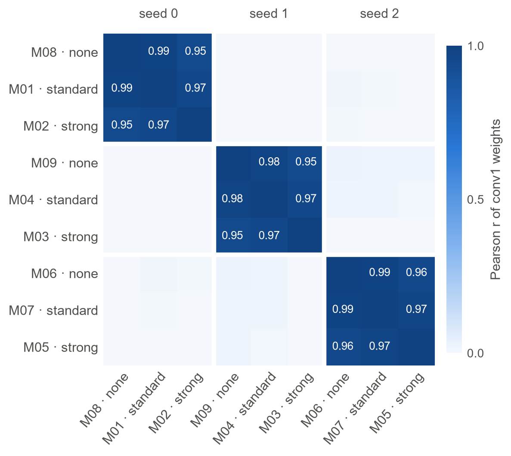
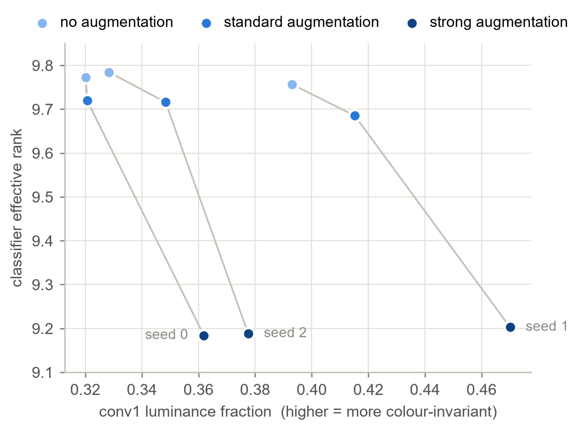
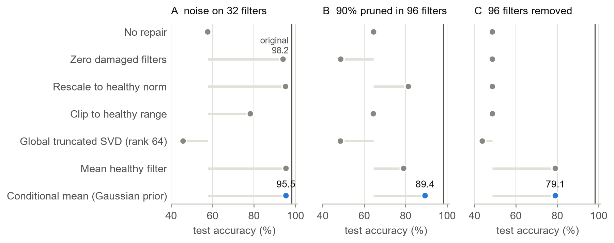
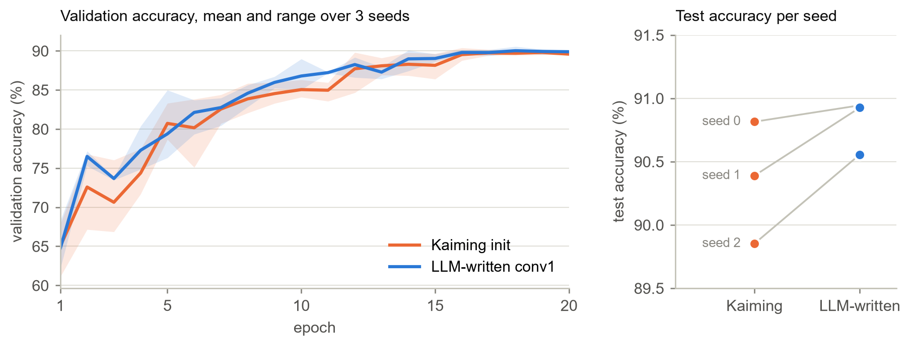
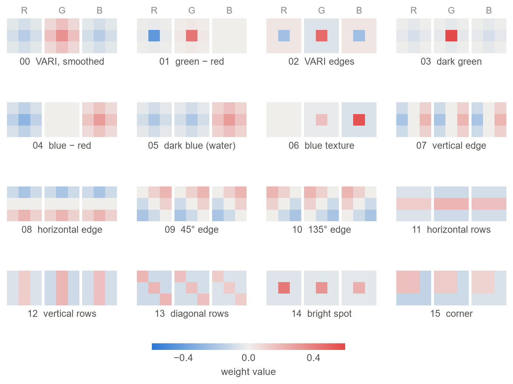

# Weight-space programming on EuroSAT

Can a language model work directly with neural network weights, reading them, repairing them and writing them, without data or gradient descent? This repository tests that on EuroSAT satellite imagery, following the framework of Takehi, Teoh, Zhang and Khattab, [*Sparks of Weight-Space Programming*](https://rikiyat.github.io/blog/weight-space-programming/) (MIT CSAIL, 2026).

Claude Fable 5.1 ran all three experiments in one Claude Code session on 10 November 2026. It had terminal access to this repository and blindness rules on the answer keys. How it reasoned is written up in [`eurosat_wsp/runs/fable_reasoning_log.md`](eurosat_wsp/runs/fable_reasoning_log.md).

**Scope.** This is a tool-assisted pilot, not a replication of Takehi et al. Fable could use Python throughout, wrote only the first layer in the WRITE experiment, and repaired random noise rather than a behavioural flaw. The READ result is genuine weight-space reading. The EDIT result shows sound diagnosis with a simple edit. The WRITE result is not weight-space programming in Takehi et al.'s sense, because training followed. See [how this relates to Takehi et al.](docs/comparison_with_takehi_et_al.md). The follow-up experiments W1 and W2 below test their write claim directly, with no tools and no training.

## Results

| Experiment | Task | Fable 5.1 | Reference |
|---|---|---|---|
| READ | Label 9 blind CNNs by training regime from their weights | 9 / 9 correct | 1 in 1,680 by chance |
| EDIT | Repair a noise-damaged ResNet-18 layer from the tensor alone | 95.5% test accuracy | 57.7% damaged, 98.2% original, 94.1% by zeroing the damaged filters |
| WRITE | Hand-write the first conv layer of a CNN, then train it | 90.81% ± 0.22 over 3 seeds | 90.35% ± 0.48 with Kaiming initialisation |

### Follow-up: writing whole networks with no tools and no training

The pilot let Fable use Python and train afterwards. Three follow-up experiments test Takehi et al.'s stronger claim directly. They were run on 11 November with **Claude Fable 5.2** (the pilot used Fable 5.1), in a claude.ai chat with code execution, web search and memory switched off, and every network was evaluated exactly as written, with no training. Designs and success criteria were fixed before any attempt ([docs/next_steps.md](docs/next_steps.md)).

| Experiment | What Fable wrote | Test accuracy | Reference points |
|---|---|---|---|
| W1 | All 618 weights of a one-layer CNN, typed as numbers in one reply | **49.4%** (1 attempt) | best constant guess 11.3%, mean-colour classifier 30.4%, same network trained 62.9% |
| W2, round 0 | A program building all 5,418 weights of a two-layer CNN, no feedback | **40.3%** | random weights 8.1%, same network trained 78.7% |
| W2, rounds 1 to 3 | Revised programs after feedback on 1,000 validation images | **45.5%, 47.5%, 49.2%** | |
| W3, round 0 | W2 on 13-band multispectral EuroSAT, same test images, no feedback | **51.8%** | mean-spectrum classifier 48.6%, same network trained 81.5% |
| W3, rounds 1 to 3 | Revised programs after feedback | **59.0%, 60.4%, 59.5%** | |

Both designs are interpretable: colour, darkness, smoothness and edge detectors feeding a nearest-centroid classifier whose class profiles Fable estimated from its own knowledge of EuroSAT. Feedback improved the result every round, by re-estimating those profiles rather than changing what the network computes. The deeper network did not beat the single-layer one (49.2% against 49.4%). The limit appears to be how well the model knows the class statistics, not network capacity.

With all 13 Sentinel-2 bands (W3), Fable built vegetation, water and bare-soil indices from the infrared bands and scored higher at every round, reaching 60.4% at best. Part of that gain is in the data itself: a trivial mean-spectrum classifier also rises, from 30.4% to 48.6%, so Fable's margin over it is smaller than with RGB. Natural classes became almost perfect (SeaLake 99%, Forest 96%, River 83%), while highways, houses and industrial sites stayed hard to tell apart, and feedback stopped helping after one round. Used as a starting point for training (pre-registered follow-up), Fable's multispectral network beat standard Kaiming initialisation on every seed at every label budget, once its oversized classifier was rescaled (predictions unchanged): 86.3% against 82.8% with all labels, 76.2% against 69.4% with 10%, and 67.5% against 63.7% with 1%. Used exactly as written, its classifier saturates and training becomes unstable.

Logs: [W1](eurosat_wsp/experiment_4_write_full/), [W2](eurosat_wsp/experiment_5_write_code/runs/log.md), [W3](eurosat_wsp/experiment_6_write_multispectral/runs/log.md).

### READ: the seed structure is visible in the weights



*The nine models fall into three groups that share a random initialisation. Within a group, first-layer weights correlate at 0.95 to 0.99; across groups, below 0.07. Since each regime was trained once per seed, every group holds one model of each regime.*



*Within each seed, stronger augmentation makes first-layer filters more colour-invariant and the classifier more concentrated. Lines join models that share a seed. Absolute values differ by seed, which is why the ordering only becomes clear within a seed.*

### EDIT: neutralising is the right repair when the signal is gone



*Seven repair methods that use only the damaged tensor, on three corruption types. Gray stems run from the damaged model's accuracy to the repaired accuracy. On variant A the noise is 35 times stronger than the weights, so the damaged filters cannot be reconstructed, and setting them to zero already recovers most of the accuracy. The conditional-mean method, the same estimator Fable chose, matters most when part of the signal survives (B) or a whole block is missing (C). Truncated SVD, the textbook suggestion, makes every variant worse.*

Fable worked only on variant A. Variants B and C, and every method other than Fable's, were added afterwards as baselines.

### WRITE: hand-written filters train at least as well as random ones



*Left: validation accuracy over 20 epochs, mean and range over three seeds. Right: test accuracy for each seed, with lines joining runs that share all other weights. Fable's first layer came out ahead on all three seeds, by 0.13, 0.54 and 0.70 points. With three seeds this is suggestive, not significant (paired t-test, p ≈ 0.12).*



*The 16 filters Fable wrote, shown per colour channel; red is positive and blue negative. Filters 0 to 6 contrast colours (vegetation, water), filters 7 to 10 detect edges, 11 to 13 detect crop rows, and 14 and 15 detect bright spots and corners.*

## Limitations

- **One model, one run.** The results come from a single session of a single model. Other models, or reruns of the same one, may behave differently.
- **Small READ test.** Nine models in three regimes. The seed structure that made the task tractable is a property of this setup and would not exist if every model had its own seed.
- **Variant A has an easy baseline.** Zeroing the damaged filters reaches 94.1% against Fable's 95.5%.
- **Three seeds for WRITE.** Enough to show the hand-written layer is not worse; not enough to claim it is better.
- **Answer keys are in the repository.** Anyone evaluating a new model must withhold `eurosat_wsp/prompts/key_*.json`, `experiment_1_read/checkpoints/` and `experiment_2_edit/original/` from it.
- **Tools were allowed in the pilot.** Takehi et al.'s headline results use no tools at all. W1 and W2 follow that rule; the no-tools versions of READ and EDIT are still planned in [docs/next_steps.md](docs/next_steps.md).
- **W1 rests on a single attempt.** The pre-registered second attempt was skipped to save model usage, so W1's 49.4% may be a favourable draw. W2 is one chat of four rounds.
- **The model used remembered knowledge of EuroSAT.** In W1 it cited dataset colour statistics from memory. This is allowed, but it means part of the result reflects training-time knowledge of this specific benchmark.

## Reproduce

Tested with Python 3.14 and CUDA 12.6. Install PyTorch for your CUDA version first, then:

```bash
pip install -r requirements.txt

# READ: score a response against the blind key
python eurosat_wsp/wsp.py eval-read \
  --response eurosat_wsp/runs/read_run_001/raw_response.txt \
  --key eurosat_wsp/prompts/key_read_exp1_all9_models.json

# EDIT: Fable's repair on variant A, then every repair method on variants A, B and C
python eurosat_wsp/wsp.py eval-edit \
  --repair-script eurosat_wsp/runs/edit_run_001/parsed_output/repair_script.py --variant A
python eurosat_wsp/run_edit_baselines.py

# WRITE: zero-shot, then 20-epoch training for one seed (repeat with --seed 1 and 2)
python eurosat_wsp/wsp.py eval-write --weights eurosat_wsp/runs/write_run_001/parsed_output/first_conv_fable.pt
python eurosat_wsp/wsp.py eval-write --weights eurosat_wsp/runs/write_run_001/parsed_output/first_conv_fable.pt --train --seed 0
python eurosat_wsp/wsp.py eval-write --weights eurosat_wsp/experiment_3_write/baseline/first_conv_kaiming_seed0.pt --train --seed 0

# Figures (saved to assets/ as PNG and SVG)
python eurosat_wsp/generate_figures.py
```

The dataset, [`blanchon/EuroSAT_RGB`](https://huggingface.co/datasets/blanchon/EuroSAT_RGB), downloads on first use. Train, validation and test splits are fixed by the manifests in `eurosat_wsp/data/splits/`.

## Repository layout

```text
assets/                    figures (PNG for the web, SVG for print)
docs/
  comparison_with_takehi_et_al.md   what this pilot shares with the MIT study and where it differs
  next_steps.md                     pre-registered no-tools experiments: write, read, edit
eurosat_wsp/
  wsp.py                   command-line entry point: prepare, parse, eval-read, eval-edit, eval-write
  wsp_eval.py              evaluators
  wsp_prompts.py           prompt and key generation
  wsp_serializer.py        weights-to-text serialisation
  wsp_parser.py            parses model responses into tensors or code
  common.py                data loading, SmallCNN, training loop
  read_features.py         READ fingerprints: seed groups, colour invariance, classifier rank
  edit_repairs.py          tensor-only repair methods
  run_edit_baselines.py    evaluates every repair method on every corruption variant
  generate_figures.py      rebuilds every figure from result files
  experiment_1_read/       nine SmallCNN checkpoints and their training metrics
  experiment_2_edit/       damaged ResNet-18 checkpoints, corruption configs, repair results
  experiment_3_write/      first-layer specs, Kaiming baselines, multi-seed training results
  runs/
    fable_reasoning_log.md   how Fable reasoned through each experiment
    read_run_001/            Fable's READ answer and analysis code
    edit_run_001/            Fable's repair function and its justification
    write_run_001/           Fable's filters, generator script and evaluation logs
    final_wsp_report.md      Fable's own report, as written at the end of the run
    evidence/                full session record, blindness audit and file hashes
```

## Citation

```bibtex
@misc{takehi2026weightspace,
  title        = {Sparks of Weight-Space Programming: LLMs can natively read \& write neural network weights},
  author       = {Takehi, Rikiya and Teoh, Jayden and Zhang, Alex and Khattab, Omar},
  year         = {2026},
  month        = nov,
  howpublished = {\url{https://rikiyat.github.io/blog/weight-space-programming/}}
}
```
